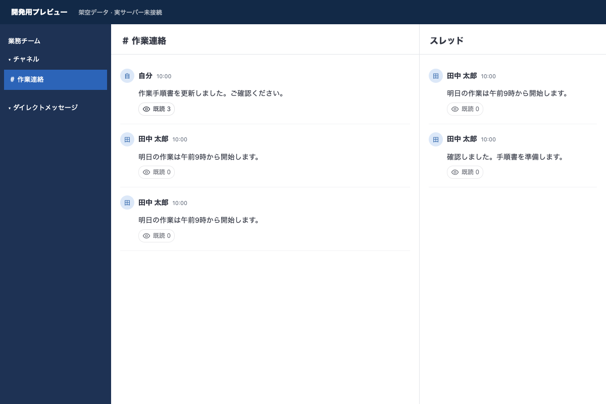
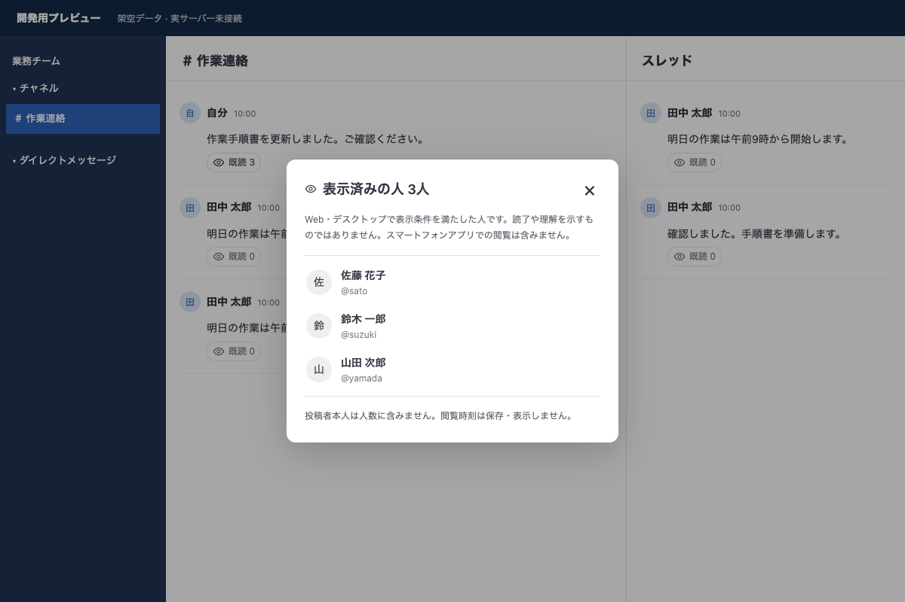

# Mattermost 表示確認（既読）プラグイン

Team Edition 12.0.1を対象に作成した独自プラグインです。チャネル・DM・グループDM・スレッドの投稿が、Web／デスクトップの前面に連続表示されたことを記録します。メンションの有無やチャネルの最終閲覧時刻では判定しません。

**実機でのインストール、既読人数と名前一覧の基本表示について利用者から動作報告を受けています。スレッド・画面外・別タブなどの判定と、実際の複数アカウントによる一連の受入確認は継続中です。** 自動テストは独立した検証画面と模擬APIを使用しており、実機での確認とは区別しています。

## 表示とプライバシー

- 投稿のフッターに、目のアイコンと「既読 3」などの人数を表示します。投稿者本人は人数に含みません。
- 投稿者だけがクリックして既読者の名前・ユーザー名を確認できます。システム管理者でも投稿者でなければ、この一覧APIは利用できません。
- 同じ投稿をチャネル・右側スレッド・スレッド画面で開いた場合、記録は共通です。親投稿と各返信は独立です。
- 他のメンバーには人数のみ表示します。「未読者名」「閲覧時刻」「勤務状況」は表示しません。
- プラグインの保存データは投稿ごとのユーザーID集合と保存対象日数です。正確な閲覧時刻、本文、IPアドレス、端末情報を保存データに含めません。名前は一覧を開く際にMattermostから取得します。
- 対象投稿に現在アクセスできるチャネルメンバーだけがAPIを利用できます。脱退者・無効化ユーザーは人数・一覧から除外します。
- 通常のMattermost／プロキシのアクセスログ、DBの管理情報、バックアップ等まで時刻情報を消す機能ではありません。基盤側のログ保持・バックアップ管理は別途必要です。

## 「既読」の定義

初期値は次の条件を**連続1秒**満たすことです。文字数に応じた読了時間ではありません。

1. ブラウザの `visibilityState` が `visible`、かつ `document.hasFocus()` が真。
2. 本文の横幅の50%以上、縦方向は「本文の高さとスクロール表示領域の高さの小さい方」の50%以上が表示されている。
3. 祖先要素のスクロール・折り畳みでクリップされた領域を除外する。
4. 表示部分の5点を調べ、3点以上で本文が最前面にある。ダイアログ等による遮蔽を除外する。
5. 条件が外れた場合は計測をリセット。250msを超える計測間隔の空白もリセット。

本文がない添付のみの投稿は添付領域で判定します。本文と添付がある投稿では本文表示の確認であり、添付ファイルを開いたことは意味しません。長文は一部の表示でも条件を満たすことがあり、全文を読んだ証明にはなりません。折り畳みが小さすぎる場合は展開が必要です。

計測は100ms間隔とスクロール等のイベントで行います。人数は約5秒間隔で更新します。ネットワーク・処理遅延があるため「ちょうど1秒後に他の人の画面が更新される」保証はありません。

## 対象と制限

| 項目 | 対応方針 |
|---|---|
| 通常の公開／非公開チャネル、DM、グループDM | 対象。チーム有料ライセンスに依存するAPIは使用しない |
| チャネル通常表示、右側スレッド、スレッド画面の親投稿・返信 | 対象の表示コンテナを12.0.1ソースで確認。実機確認は後述 |
| Web・デスクトップ | 同じWebプラグインで対応する設計。実デスクトップアプリは未検証 |
| スマートフォンのネイティブアプリ | 対象外。モバイルアプリのセッションからの記録要求も拒否 |
| スマートフォンのWebブラウザ | 同じWebアプリがプラグインをロードした場合は動作対象。ネイティブアプリと区別する |
| システム投稿・独自のカスタム投稿タイプ | 対象外。標準投稿（typeが空）のみ |
| 検索結果・保存済み投稿等の特殊表示 | 表示記録の対象外。通常／スレッドのコンテナ以外では記録しない |
| 変更された本文 | 投稿ID単位の記録を維持。編集後の再読を証明しない |
| ネットワーク切断 | サーバー保存できた分のみ。再表示で再計測。未送信履歴を永続保存しない |
| 名前が一覧にない人 | 未閲覧の証明ではない。モバイル閲覧、通信失敗、対象外表示等があり得る |
| 改ざん耐性 | クライアントからの申告方式。自分の既読をAPIで偽装する利用者を検出する仕組みではない |
| 画面を実際に見ていたか | 注意・読了・理解・対応可能な状態を証明しない。OSや外部機器の画面状態を完全には検出できない |

## 導入

詳細は [docs/導入と受入確認.md](docs/導入と受入確認.md) を参照してください。インストール用ファイルは `dist/com.nito.viewport-read-receipts-0.1.1.tar.gz` です。

初期状態では **TrackingEnabled=false** です。まず検証用チャネルだけを指定し、利用目的・対象・誰に何が見えるか・保存期間を利用者に説明したうえで有効化してください。サーバーの設定やプラグイン署名ポリシーによっては独自プラグインのアップロードが許可されていない場合があります。

| 設定 | 初期値 | 説明 |
|---|---|---|
| TrackingEnabled | false | 記録・人数・一覧のAPIを有効化 |
| DwellMilliseconds | 1000 | 連続表示時間。250〜10000ms |
| RetentionDays | 30 | 投稿作成からの日数。1〜365日 |
| ChannelIDs | 空欄 | 対象チャネルIDをカンマ区切り。空欄は全対象種別 |

保存期限は最初の閲覧からではなく**投稿作成時刻を起点**に計算します。同じ人の再表示や追加の読者によって期限を延長しません。期間設定を延ばしても既存レコードの期限は延長しません。短縮時は取得時の対象判定にも直ちに適用します。ただし、すでに保存したKVの物理的な削除期限は、次の更新がなければ以前の期限のままです。厳格な即時消去が必要な場合はそのまま期間設定を変更せず、別途データ消去手順を整備してください。投稿削除時にも記録の削除を要求します。

設定変更の画面側への反映は最大約30秒です。再読み込みで直ちに取得できます。サーバー側の無効化・対象制限は次のAPI要求から適用します。

## フォルダ構成

```text
mattermost-plugin-viewport-read-receipts/
├── .github/workflows/     # 公開後の自動チェック
├── assets/               # 架空データによる画面例
├── build/                # 配布用パッケージの作成処理
├── docs/                 # 導入・仕様・確認状況
├── server/               # Goのサーバー処理とテスト
├── webapp/
│   ├── src/              # 画面表示と表示検知
│   ├── tests/            # ブラウザテストと検証用画面
│   ├── package.json      # Web依存管理と実行コマンド
│   └── playwright.config.ts
├── dist/                 # 生成したインストール用tar.gz（Git管理外）
├── Makefile
├── go.mod
└── plugin.json
```

## 開発・ビルド

Go 1.24.6以降、Node.js 22以降（開発環境の指定は `.nvmrc`）、npm、Python 3、makeが必要です。リポジトリのルートで実行します。

```sh
make deps
npm --prefix webapp exec -- playwright install chromium
make check-style
make test
make dist
```

Linuxでブラウザのシステム依存パッケージも必要な場合は、Playwrightの [CI手順](https://playwright.dev/docs/ci-intro) に従い `playwright install --with-deps chromium` を実行します。既にインストールしたブラウザを使う場合だけ、`PLAYWRIGHT_CHROMIUM_EXECUTABLE_PATH` に実行ファイルのパスを指定できます。特定の利用者やOSのパスを既定値にはしていません。フォーカス切り替えの検証に対応するため、既定は `channel: chromium` の新しいヘッドレスモードです。[Playwrightのブラウザ説明](https://playwright.dev/docs/browsers#chromium-new-headless-mode) を参照してください。

`make dist` はLinux amd64／arm64、macOS arm64のサーバーバイナリとWebバンドルを作成し、`dist/` にアップロード用tar.gzと `SHA256SUMS` を出力します。SDKは公開版 `github.com/mattermost/mattermost/server/public v0.1.21` に固定し、12.0.1のソースでも利用APIの存在を確認しています。

## 画面例

以下は実装したWebバンドルを検証用画面に読み込んだものです。名前・本文は架空データで、実運用の投稿や利用者情報は含みません。





## 公開と配布

ソースはGitで管理し、インストール用tar.gzと `SHA256SUMS` は [GitHub Releases](https://docs.github.com/en/repositories/releasing-projects-on-github/about-releases) 等で別途配布する方針です。GitHubが自動で作成するソースアーカイブと、Mattermostにアップロードするインストール用tar.gzは異なります。

GitHub Actionsのチェック・テスト・配布ファイル作成用設定を同梱しています。リモート上での実行はまだ確認していません。公開の手順は [公開とリリース](docs/公開とリリース.md) を参照してください。

## 実装と検証の根拠

[設計と検証](docs/設計と検証.md)、[確認状況](docs/検証結果.md)、[変更履歴](CHANGELOG.md) を参照してください。

## ライセンス

本プロジェクトのソースコードは [Apache License 2.0](LICENSE) で公開します。依存コンポーネントにはそれぞれのライセンスが適用されます。[NOTICE](NOTICE)、`go.mod` と `webapp/package-lock.json` を参照してください。Mattermost公式の製品ではありません。
